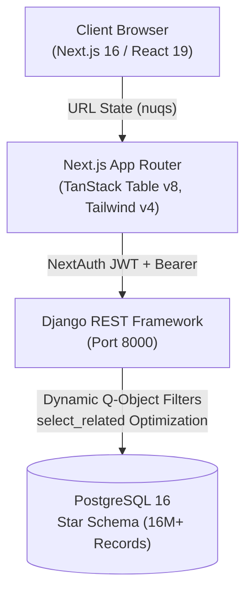
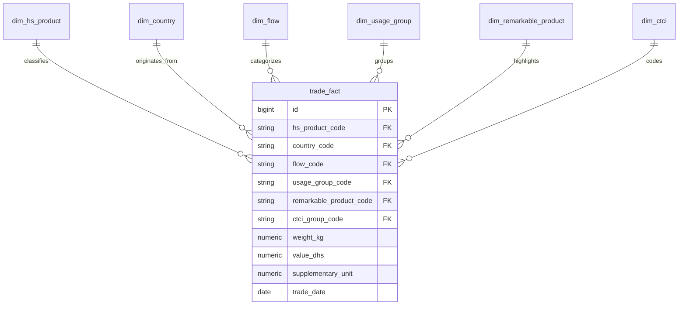

# Mubadala — Foreign Trade Data Analysis Platform 🇲🇦

[](https://nextjs.org/)
[](https://react.dev/)
[](https://www.typescriptlang.org/)
[](https://tailwindcss.com/)
[](https://www.djangoproject.com/)
[](https://www.django-rest-framework.org/)
[](https://www.postgresql.org/)
[](https://www.docker.com/)

A full-stack, enterprise-grade trade data analytics and exploration platform designed to ingest, process, and query Moroccan foreign trade statistics across **16M+ historical records** with sub-second response times.

---

## 🎯 Overview

**Mubadala** is a web platform designed to explore and analyze Moroccan foreign trade statistics. It provides an interactive interface to search, filter, and analyze trade flows, partner countries, and product classifications across millions of records.

### Key Features

* **Interactive Trade Table**: Fast browsing, sorting, and multi-criteria filtering across trade transactions.
* **Shareable Views**: Search and filter states are saved in the URL for instant bookmarking and sharing.
* **Analytical Data Model**: Star schema database structure modeled for multidimensional trade analysis.
* **User Authentication**: Secure sign-in with Google OAuth and session management.

---

## 🏗️ System Architecture



### Technology Stack

| Layer | Technologies |
| :--- | :--- |
| **Frontend** | Next.js 16 (App Router), React 19, TypeScript (Strict), TanStack Table v8, `nuqs`, Tailwind CSS v4, Radix UI, Framer Motion |
| **Backend** | Python 3.12, Django 5.2, Django REST Framework 3.16, `django-allauth`, `dj-rest-auth`, `simplejwt` |
| **Database** | PostgreSQL 16 (Star Schema with fact & dimension tables, `psycopg3`) |
| **DevOps** | Docker, Docker Compose |

---

## 🗄️ Data Model (Star Schema)

The analytical core uses a dimensional star schema where trade transactions are recorded in `trade_fact` and linked to six normalized dimensions:



* **`trade_fact`**: Central fact table storing measurable metrics (`weight_kg`, `value_dhs`, `supplementary_unit`, `trade_date`).
* **`dim_hs_product`**: Harmonized System (HS) product hierarchy (codes, labels, chapters).
* **`dim_country`**: Partner country codes, names, and continents.
* **`dim_flow`**: Trade flow types (Imports CAF, Exports FOB, temporary admissions, re-exports).
* **`dim_usage_group`**: Economic utilization categories.
* **`dim_remarkable_product`**: Key Moroccan commodities (phosphates, automotive, agriculture, textiles).
* **`dim_ctci`**: Standard International Trade Classification (SITC/CTCI) hierarchy.

---

## 📁 Repository Structure

```
.
├── back/                           # Django REST API service
│   ├── apps/
│   │   ├── authentication/         # User model, Google OAuth synchronization, JWT auth
│   │   └── trade/                  # Star schema models, Q-filter builder, pagination, views
│   ├── config/                     # Django settings, URLs, WSGI/ASGI configuration
│   └── Dockerfile                  # Backend container specification
├── front/                          # Next.js frontend application
│   ├── src/
│   │   ├── app/                    # App Router routes (/, /trades, /auth, /design-system)
│   │   ├── components/             # TanStack data table, filter toolbars, landing sections
│   │   ├── config/                 # Design tokens and table configurations
│   │   ├── hooks/                  # Custom hooks (useTradeData, useDataTable)
│   │   ├── lib/                    # API clients, filter builders, auth options
│   │   └── styles/                 # Design system tokens and globals
│   └── Dockerfile                  # Frontend container specification
├── docker-compose.yml              # Container orchestration
└── README.md                       # Project overview
```
